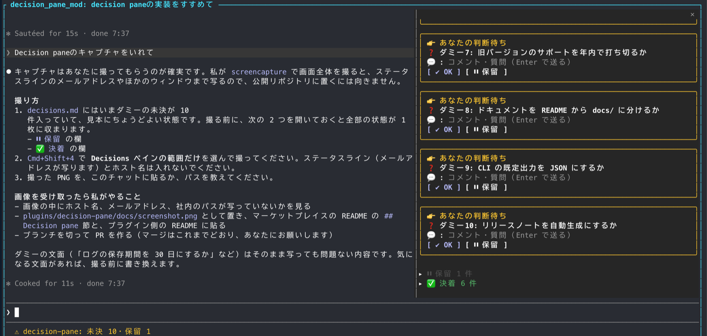
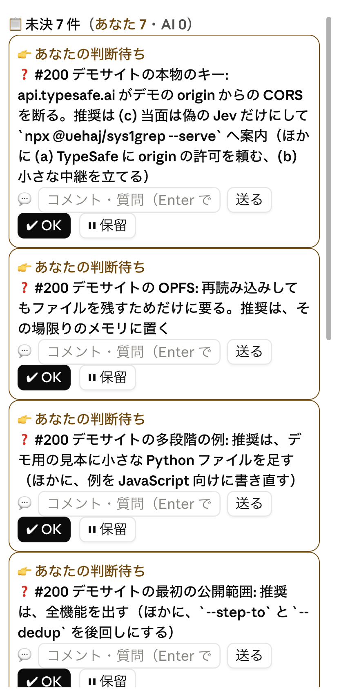

# uehaj/uehaj-marketplace

Claude Code plugin marketplace by [uehaj](https://github.com/uehaj). Three plugins:
`uehaj` holds the skills, so every skill is `/uehaj:<skill>`; `playground` holds function-hook
experiments that draw in a pane; `decision-pane` lists the decisions waiting on you in a pane.

```sh
claude plugin marketplace add uehaj/uehaj-marketplace   # or: /plugin marketplace add uehaj/uehaj-marketplace
claude plugin install uehaj@uehaj-marketplace           # the skills
claude plugin install playground@uehaj-marketplace      # the pane experiments
claude plugin install decision-pane@uehaj-marketplace   # the decisions pane
```

Update later with `claude plugin marketplace update uehaj-marketplace`.

To install a single skill instead of the whole plugin, use the [skills CLI](https://skills.sh/).
It copies the skill into `~/.claude/skills/` (with `-g`) or `./.claude/skills/`, and the skill is then
invoked without the plugin prefix (`/sys1grep` instead of `/uehaj:sys1grep`).

```sh
npx skills add uehaj/uehaj-marketplace --skill sys1grep -a claude-code -g
```

## Skills

| Skill | What it does | Needs |
|---|---|---|
| `/uehaj:sys1grep <meaning> [files]` | grep by meaning, with sys1grep 0.5.0-next.1 (the renamed semgrep): the same, plus git commits (`-g`) and auto-scope by time, language, place, author and git state. | [`@uehaj/sys1grep@0.5.0-next.0`](https://github.com/uehaj/sys1grep), run through `npx`, and a TypeSafe API key |
| `/uehaj:semgrep <meaning> [files]` | grep by meaning. Finds lines that match a described meaning, in any language, with AND / OR / NOT. | [`@uehaj/semgrep`](https://github.com/uehaj/jev-semgrep) (`npm install -g @uehaj/semgrep`, or the skill falls back to `npx`) and a TypeSafe API key |
| `/uehaj:run-interactive <command>` | runs a command that needs a human at the keyboard (`rm -i`, `git commit -p`, `git rebase -i`, an ssh login) in a herdr side pane wrapped in `script`, hands focus to the human, and when they finish collects the exit code and the full log, their keystrokes included. Claude's Bash tool cannot take interactive input; this is the way round it. Model-invoked. | [herdr](https://herdr.dev) (`HERDR_ENV=1`), `script`, `python3` |
| `/uehaj:ri <command>` | short alias for `/uehaj:run-interactive`. | same |
| `/uehaj:gh-issue-map [owner/repo] [--since 6m]` | collects a GitHub repository's issues, PRs and commits (read-only GraphQL through `gh`) and writes one self-contained HTML page: a table of issues with the PRs and commits that work on them, and a graph whose edges are blocked-by, PR to issue (closing references, `Closes #N` in the body, or the branch name), stacked PRs, shared commits and mentions; sub-issues are drawn as frames. Model-invoked. | [`gh`](https://cli.github.com/) (logged in), `python3` |
| `/uehaj:coordinator [N]` | turns this session into a coordinator: opens N worker sessions (default 3; through herdr, `claude --bg`, or by asking you to open terminals), gives each a worker prompt, then hands out issues and PRs over cross-session messages (SendMessage / ListAgents), answers the workers' questions or brings them to you, has a separate subagent review each PR, and reports conclusions, decisions taken, questions for you and work in flight. Keeps its state in `workdir/coordinator-state.md` so it can resume after `/clear`. Invoked by hand only. | Claude Code with SendMessage and ListAgents (checked on 2.1.289), `gh`; optionally [herdr](https://herdr.dev) |
| `/uehaj:hatena-x-comment-refine` | rewrites the comments on your Hatena Bookmark entries for x.com posts: reads each post in the browser, drafts `[tag][tag] summary` comments (leaning on tags you already use), shows you the list for approval, writes them through the bookmark edit form, and checks the result against the RSS feed. Defaults to the latest 100 bookmarks with comments of 15 characters or fewer. Model-invoked. | [Claude in Chrome](https://claude.com/chrome), logged in to Hatena and X in that browser |

## Playground

Experiments on Claude Code's function-hooks API, which draws in a pane beside the transcript.
They need `CLAUDE_CODE_ENABLE_FUNCTION_HOOKS=1` in `~/.claude/settings.json`.

| Command | What it does |
|---|---|
| `/img </abs/path.png>` | shows a PNG in a pane, through the terminal surface's native `Image` element |
| `/mandel [cx cy width]` | draws the Mandelbrot set, computed into RGBA bytes and handed to the same element |

Both use kitty graphics, so they need a terminal that has it (kitty, Ghostty). Claude Code decides
by the name the terminal reports, and a libghostty-based multiplexer such as herdr reports
`libghostty`, which is not on that list — the image then falls back to its alt text. Set
`CLAUDE_CODE_FORCE_TERMINAL_IMAGES=1` there; the probe itself succeeds, only the name check fails.

## Decision pane





A pane listing the open items (`- [ ] ...`) of `decisions.md` in the working directory, so a decision the AI
is waiting on does not scroll away in the chat. Each item is a card whose color and icon say whose turn it is
(👉 yours, ⏳ the AI's), with the comments (💬) and answers (🤖) under it, a comment field, and two buttons:

- **✔ OK** rewrites the line as `- [x] ... (承認 YYYY-MM-DD HH:MM)` and moves it to the folded ✅ settled section,
  newest first.
- **⏸ Hold** rewrites it as `- [~] ... (保留 YYYY-MM-DD HH:MM)` and folds it into the ⏸ held section, from which
  **▶ Resume** puts it back.
- A **comment** adds `  - コメント YYYY-MM-DD HH:MM: ...` under the item and leaves it open, so the AI can answer
  (`  - 回答: ...`) and refine the item's text.

The status line shows the open and held counts; `/decisions` opens the pane when the terminal is too narrow to
open it unasked. It calls no model: telling the AI about a change is left to whatever watches `decisions.md`.
The line format is the contract with that watcher; see
[plugins/decision-pane/README.md](plugins/decision-pane/README.md) (Japanese). Needs
`CLAUDE_CODE_ENABLE_FUNCTION_HOOKS=1`, like the playground. Install it at the user scope and it loads in the
desktop app's local sessions too.

## Layout

```
.claude-plugin/marketplace.json     the catalog (marketplace name: uehaj-marketplace)
plugins/uehaj/
  .claude-plugin/plugin.json        the plugin (name: uehaj)
  skills/<skill>/SKILL.md           one folder per skill, with any scripts the skill runs beside it
plugins/playground/
  .claude-plugin/plugin.json        the plugin (name: playground)
  hooks/hooks.json                  names the module the engine loads
  hooks/register.tsx                registers both commands, then each file's hooks
  hooks/{img,mandel}.tsx            one command each
  hooks/pane.ts                     base64 without Buffer, and the pane's size in cells
plugins/decision-pane/
  .claude-plugin/plugin.json        the plugin (name: decision-pane)
  hooks/register.tsx                the pane: OK, hold, comment, folded sections, /decisions
  hooks/approve.test.tsx            claude plugin test: what OK, hold, resume and a comment write
  types/index.d.ts                  the pane's state contract
```

Tools with their own release cycle (sys1grep, semgrep) live in their own repositories; a skill's small
helper scripts (`run-interactive.sh`, `gh-issue-map/tools/`) and longer references (`coordinator/references/`)
live beside its SKILL.md.

## License

MIT
