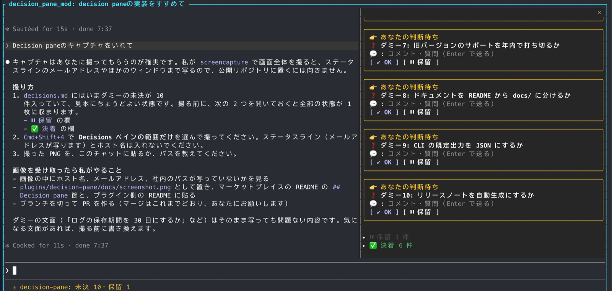
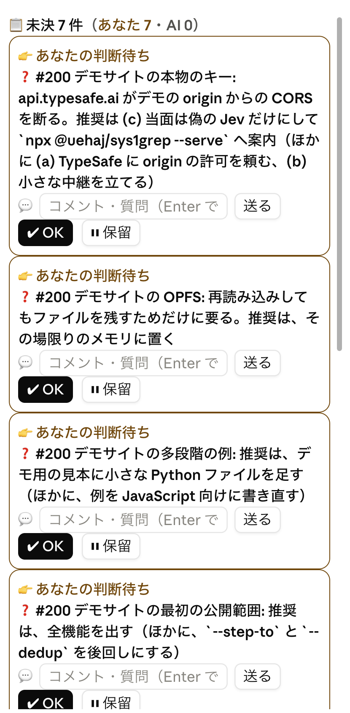

# decision-pane

作業ディレクトリかその上で最も近い `decisions.md` から未決の行をペインに一覧し、OK ボタン 1 つで承認済みに書き換える Claude Code の mod。LLM は呼ばない。





## 使い方

- セッション開始時にペインが開く。端末の幅が足りず開かないときは `/decisions` で開く。
- ステータスラインに件数（`未決 N`、保留があれば `未決 N・保留 M`）が出る。
- 各未決に、子行（コメントと AI の回答）、選択肢のボタン（あれば）、コメント欄、OK と保留のボタンが並ぶ。コメント欄が出るのは terminal と desktop だけ（mobile には入力欄の要素がない）。
- `decisions.md` は、作業ディレクトリから上へ、git リポジトリの最上位（`.git` フォルダのある所）までたどって最初に見つかったものを使う（サブフォルダや中の worktree に cd しても、リポジトリのものが出る）。リポジトリの外では作業ディレクトリのものだけ。リンクは読まない。
- `decisions.md` は 3 秒ごとに見る。更新時刻が変わったときだけ読み直す。

## decisions.md の書式（契約）

| 行 | 意味 |
|---|---|
| 行頭が `- [ ] ` | 未決。ペインに出る |
| 行頭が `- [x] ` | 承認済み（決着）。ペインのたたまれた決着欄に、承認の新しい順で出る |
| 行頭が `- [~] ` | 保留。ペインのたたまれた保留欄に出る。AI の番でもあなたの番でもない |

未決の行の直後に続く、字下げした行は、その未決の子行としてペインに出す。

**OK** を押すと、その行を次の形に書き換え、決着欄に移す。子行とほかの行には触らない。

```
- [ ] 文面
↓
- [x] 文面 (承認 YYYY-MM-DD HH:MM)
```

**選択肢**: 未決の子行のうち `- (a) 説明` の形のもの（括弧の中は英字 1 文字。`(注)` や `(1)` はふつうの子行のまま）は、子行としてではなくボタンとして出る。押すと OK と同じく `- [x] … (承認 …)` に書き換え、子行の末尾に選んだものを足す。

```
- [ ] 保存先: どれにするか。推奨は、(a)
  - (a) SQLite
  - (b) Postgres
↓ (b) を押す
- [x] 保存先: どれにするか。推奨は、(a) (承認 YYYY-MM-DD HH:MM)
  - (a) SQLite
  - (b) Postgres
  - 選択: (b) Postgres
```

選択肢があっても OK は使える。OK は推奨案での承認の意味になる。

**コメント欄**に書いて Enter を押すと、未決のまま、子行の末尾にコメントを足す。

```
- [ ] 文面
  - 回答: ...                              ← AI が以前に書いた子行
  - コメント YYYY-MM-DD HH:MM: 本文        ← mod が足す
```

コメントを受けた AI は、`  - 回答: ...` を子行に足して答え、必要なら `- [ ] ` の後ろの文面を書き直す。mod は未決を文面で見分けるので、文面を書き直しても子行は付いてくる。

**保留**を押すと、未決を次の形に書き換え、ペインの下のたたまれた「保留」欄に移す。子行は付いてくる。保留欄を開いて **戻す** を押すと、元の `- [ ] 文面` に戻る。

```
- [ ] 文面
↓
- [~] 文面 (保留 YYYY-MM-DD HH:MM)
```

決着欄を開いて **未決に戻す** を押すと、`- [x] 文面 (承認 …)` を `- [ ] 文面` に戻す。`- 選択: ` で始まる子行（選択肢のボタンで足したものも、手で書いたものも）は消し、ほかの子行は残す。

時刻はローカル時刻。

## AI への伝わり方

この mod は AI に何も送らない。承認やコメントが AI に届くのは、Claude Code 本体の働きによる。AI が Read ツールで一度読んだファイルが外で書き換わると、Claude Code は AI が次に動くとき（あなたが何か送ったとき、バックグラウンドの処理の完了通知が来たときなど）に、その差分を AI に添える。だから AI がセッションの初めに `decisions.md` を Read ツールで読んでおけば、ボタンでの書き換えは次のやりとりで AI に届く。`cat` や `grep` など Bash で読んだだけのファイルは、この対象にならない。ボタンを押しただけでは AI は動かない。

差分を受けた AI が見るのは次のものだけ。

- 行頭の `- [x] ` と行末の `(承認 ...)` は、承認された印。子行に `- 選択: (b) ...` があればその案で、無ければ推奨案で
- `- [ ] ` の未決の下で、最後の子行が `- コメント ` で始まっていれば、AI が答える番
- 行頭の `- [~] ` は保留。誰の番でもないので無視してよい

## CLAUDE.md に足すもの

mod を入れただけでは、AI は `decisions.md` に問いを書かず、変更にも気づかない。CLAUDE.md（user スコープなら `~/.claude/CLAUDE.md`）に次のような項を足す。

```markdown
## 回答をもらっていない問いは decisions.md に書く

- ユーザーへの問い・承認待ちで、まだ回答をもらっていないものは、作業ディレクトリの `decisions.md` に追記する。
  書式は 1 件 1 行: `- [ ] <対象>: <何を決めるか>。推奨は、<推奨案>`。補足は 2 スペース字下げの子行に書く。
  選べる案が複数あるときは、案ごとに `  - (a) <案>` の子行を書く（ペインでボタンになる）。
- `- [x]` の子行に `- 選択: (b) ...` があればその案で、無ければ推奨案で承認された。
- ファイルが無ければ見出し付きで作り、`.git/info/exclude` に `decisions.md` を足してコミット対象から外す。
- `- [x]`（承認済み）・`- [~]`（保留）の行は書き換えない。
- セッションで最初に `decisions.md` に触れるときは、Bash ではなく Read ツールで読む。そうすると、ペインでの承認・コメントが次のやりとりで差分として届く。
```

## 無保証

現状のまま提供する。
